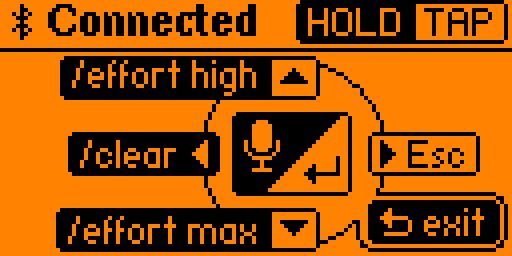

# F0 Claude Remote

> Your voice runs Claude Code. Your Flipper Zero runs the shortcuts.

A Flipper Zero app that acts as a Bluetooth remote for Claude Code on a Mac:
hold OK to dictate, tap it to send,
and use the other buttons for menus, Esc, `/clear` and the effort level.
Each action confirms itself with a buzz,
so the screen needs no watching.
To the Mac it is a Bluetooth keyboard:
one block of key bindings, and nothing to install.

<p align="center">
  
</p>

The app is debugged on the device from CLion,
with breakpoints in our sources and no Flipper plugin:
see [Debugging](#debugging).

## Getting started

You need a Flipper Zero on firmware 1.5.1,
and an Apple Silicon Mac with [mise](https://mise.jdx.dev) to build on.
With the device unlocked on USB, on its desktop:

```shell
mise trust
mise install
mise run setup
mise run launch
```

The app then lives under Apps → Bluetooth on the device.
Pair it once, and bind the keys.

## Pairing

Once per Mac, with the device on its desktop:

1. Run `mise run launch`.
   Not over the device's open Apps browser:
   the pairing dialog waits behind it, and closing the app hangs until the browser ends.
2. In the Mac's Bluetooth settings, press Connect on `Claude Remote` under Nearby Devices,
   and accept the request.
   This takes up to about 30 seconds once the device has advertised for a minute;
   press it again if it times out.
3. Press OK in `Verify code` on the device.
4. Close Keyboard Setup Assistant if it opens: the device has no keys for it.

From then on the Mac connects by itself, within a second of a drop.
To pair again, forget the device on the Mac first.
While the app is open it holds the radio, and on leaving it hands the radio back.

## Keys on the Mac

The device is a Bluetooth keyboard,
so a press acts on whatever the Mac has focused,
meant to be a Claude Code session:

| Button | Sends | In Claude Code |
|---|---|---|
| OK, tap | Enter | Sends the prompt, or picks a menu's option |
| OK, hold | Ctrl+Q, held until the release | Dictates into the prompt, sending nothing |
| Up, tap | Up arrow | Recalls the previous message, or moves up a menu |
| Down, tap | Down arrow | Recalls the next message, or moves down a menu |
| Right, press | Esc | Stops the turn |
| Up, hold | Ctrl+X, Ctrl+F | Sets effort to `high` |
| Down, hold | Ctrl+X, Ctrl+X | Sets effort to `max` |
| Left, hold | Ctrl+X, Ctrl+L | Runs `/clear` |
| Back, hold | Nothing | Leaves the app on the device |

Dictation, effort and `/clear` take one block in `keybindings.json`,
in Claude Code's config directory: `~/.claude`, or what `CLAUDE_CONFIG_DIR` names.
It goes into the file's `bindings` array, or its lines into a `Chat` block already there,
and the file reloads by itself:

```json
{
  "context": "Chat",
  "bindings": {
    "ctrl+q": "voice:pushToTalk",
    "ctrl+x ctrl+f": "command:effort high",
    "ctrl+x ctrl+l": "command:clear",
    "ctrl+x ctrl+x": "command:effort max"
  }
}
```

Tried on Claude Code 2.1.311.
Its schema has no space in a command's name,
so an editor validating against `$schema` marks the two effort lines;
they run all the same.

Ctrl+Q dictates from the Mac's own keyboard too,
since `voice:pushToTalk` takes one key.
Dictation also needs `/voice hold`, once,
and key repeat on, as macOS has it by default:
Claude Code tells a held key by its repeats,
and without them a recording ends about 2.2 s into the hold.
After the release, wait out `Voice: processing…` before tapping OK:
a tap during it sends the interim text and drops the rest.

A stray `/clear` costs one `/resume`,
which lists the previous conversation.

## Debugging

The app runs on the device, and GDB reaches it through the Black Magic probe on the WiFi Devboard.
Only our code is stepped through:
the SDK ships no firmware sources, so firmware calls are stepped over.

### Before a session

The device must run the firmware the SDK pins,
have Settings → System → Debug on, which otherwise disables its debug port,
and stay unlocked:
a PIN lock drops its USB console, and `mise run launch` fails.
Turn auto-lock off in Settings → Desktop for the session.

Attach the board in this order:

1. Pull the board's cable and power the device off.
2. Seat the board on the GPIO header.
3. Power the device on by holding Back, and enter the PIN.
4. Plug the board's cable, then the device's cable, into the Mac.

If the device will not power on,
take the board off, pull its cable, and hold Back for 30 seconds.

Take the board off and pull its cable after the session.
Its GDB port and its HTTP API have no password,
and `/api/v1/wifi/get_credentials` hands out the password of the network it joined.

### In CLion

1. Pick `Flipper` in the Debug Profiles list on the toolbar.
   CLion lists its own profiles first, so a clone needs this once.
2. Set a breakpoint in our sources.
3. Run the `Debug` configuration.
4. Run the `Launch` configuration.
   CLion stops in disassembly at `flipper_application_alloc_thread`:
   the app is loaded and its symbols are in.
5. Press Resume. CLion stops on the breakpoint.
6. Press Stop when done.
   The red `exit code 137 (interrupted by signal 9:SIGKILL)` is CLion ending GDB after it detached,
   and it is harmless.

### In a terminal

```shell
mise run debug    # GDB on the device; leave it with `quit`
mise run launch   # in another terminal
```

Leave with `quit` rather than killing the process:
this session sets the firmware's debug flag and clears it on the way out,
and with the flag left set the next app to start faults the device.

### The probe

A session finds the probe by itself,
over USB first and through `blackmagic.local` when the board has no cable.

Wi-Fi needs one cable fewer:
with the device on its own USB cable, the board runs from the GPIO header,
so skip the board's cable in the attach order and run the session as usual.

For Wi-Fi, put the board on a 2.4 GHz network once, from a phone so the Mac stays online:
join the board's `blackmagic` network, password `iamwitcher`,
open `http://192.168.4.1`, tab WiFi,
set Mode to `STA` with the network's SSID and Pass, press SAVE, then REBOOT.
Holding BOOT for 10 seconds restores the board's own network.

The board needs firmware 0.1.1:
older firmware hung starting USB, so neither USB nor GDB answered.
Flash the checked archive rather than `ufbt devboard_flash`,
which runs a command from an archive it never verifies.
Hold BOOT, press RESET, release BOOT, and the board appears as `ESP32_S2`, here on `/dev/cu.usbmodem01`:

```shell
dir=$(mktemp -d)
curl -fsS -o "$dir/fw.tgz" \
  https://update.flipperzero.one/builds/blackmagic-firmware/0.1.1/blackmagic-firmware-s2-full-0.1.1.tgz
echo "2e63724446004bd359d895d6843bb8f95cc374e27e3e37569b2e035930f845aa  $dir/fw.tgz" | shasum -a 256 -c
tar -xzf "$dir/fw.tgz" -C "$dir" ./bootloader.bin ./blackmagic.bin ./partition-table.bin
.ufbt/toolchain/arm64-darwin/bin/python3 -I -m esptool --chip esp32s2 --port /dev/cu.usbmodem01 \
  --before no_reset --after no_reset write_flash --flash_mode dio --flash_freq 80m --flash_size 4MB \
  0x1000 "$dir/bootloader.bin" 0x10000 "$dir/blackmagic.bin" 0x8000 "$dir/partition-table.bin"
```

Press RESET when it finishes.

## Toolchain

A fresh clone needs mise and nothing else;
after `mise run setup`, `clion .` opens the project.
`mise run test` alone also needs the system `cc`, unpinned.

Only `.idea/misc.xml` and `.idea/debug-profiles.xml` are tracked,
so a first `clion .` finds the compilation database and the debug profile,
and the rest of `.idea/` stays ignored.

SDK, toolchain and build output stay in `.ufbt/` and `dist/`.
Run ufbt through mise, from the repository root:

```shell
mise exec -- ufbt        # build
mise exec -- ufbt lint   # check the sources against Flipper's format
```

Never run `ufbt vscode_dist`:
it overwrites `.editorconfig` and `.gitignore`.

Project tasks are files in `.mise/tasks/`:

- `setup` deploys the pinned SDK and builds once,
  under a sandbox that denies writes outside the project and temp.
  It runs on macOS only.
- `build` builds the app.
- `test` builds the suites under `test/` with the system `cc` and runs them on the Mac,
  one `ok` line per test.
- `launch` builds it, uploads it to the device and starts it.
  `ufbt flash` is not the same thing: it rewrites the device's firmware.
- `debug` opens GDB on the device in the terminal.
- `check-workflow` runs `.github/workflows/build.yml` through `act`,
  contained, against colima's Docker socket unless `DOCKER_HOST` says otherwise.

To bump the SDK,
edit `FLIPPER_SDK_VERSION` in `mise.toml` and run `mise run setup`.

To bump a tool,
remove `[tool_config]` from `mise.toml`,
since `locked = true` refuses a graph that does not exist yet.
Change the pin, then restore the section once the new graph is locked:

```shell
mise install uv python@<version>
mise lock
mise install
```

## Workflow

Development is spec-driven, on [OpenSpec](https://github.com/Fission-AI/OpenSpec),
through Claude Code's `/opsx:*` commands.
Each change is one OpenSpec change,
and every plan is one commit.
It is planned one of two ways,
and `/opsx:sync` runs before `/opsx:archive` either way.

**Ahead.**
Each plan is proposed on `develop` and committed alone,
and may wait there, unimplemented, until its turn.
Its implementation is one commit on its own branch:

```shell
git flow feature start <id>    # right before /opsx:apply
git flow feature finish <id>   # after /opsx:sync, /opsx:archive and the commit
```

**Just in time.**
The branch comes first,
and the plan, the code and the archive go in as one commit:

```shell
git flow feature start <id>    # then /opsx:propose "<id>" and /opsx:apply on it
git flow feature finish <id>   # after /opsx:sync, /opsx:archive and the commit
```

Every implementation runs in a clean Claude Code session,
which is cleared with `/clear` once its branch is finished.

Browse specs and changes with `mise exec -- openspec view`.

To install the agent skills into `.claude/skills/` in a fresh clone,
or to update them:

```shell
mise exec -- npx skills add petr-korobeinikov/skills --skill '*' --copy --agent claude-code -y
```

## Hooks

[prek](https://prek.j178.dev/) holds the gate before a commit is allowed.
It is pinned in `mise.toml` and configured in `prek.toml`,
which gives each rule's reason.
Every hook is one of prek's own Rust implementations,
so this repository clones no hook repositories
and pins no third-party revs.

File-hygiene hooks run at `pre-commit`.
Three more read the message at `commit-msg`:
a subject of at most 72 characters,
in Conventional Commits,
and no line that credits an AI agent or a model.

```shell
mise exec -- prek install           # wire both git hooks
mise exec -- prek run --all-files   # every pre-commit hook over the whole tree
```

Run `prek install` in a fresh clone and after a prek upgrade:
the generated hooks pin the path of the prek binary they were installed from,
and that path carries the version.
